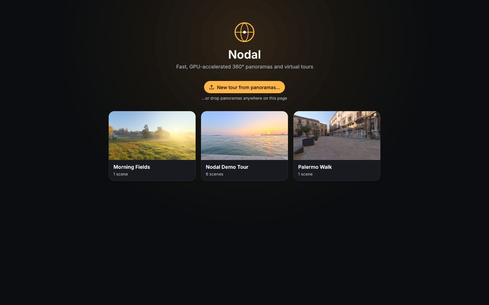
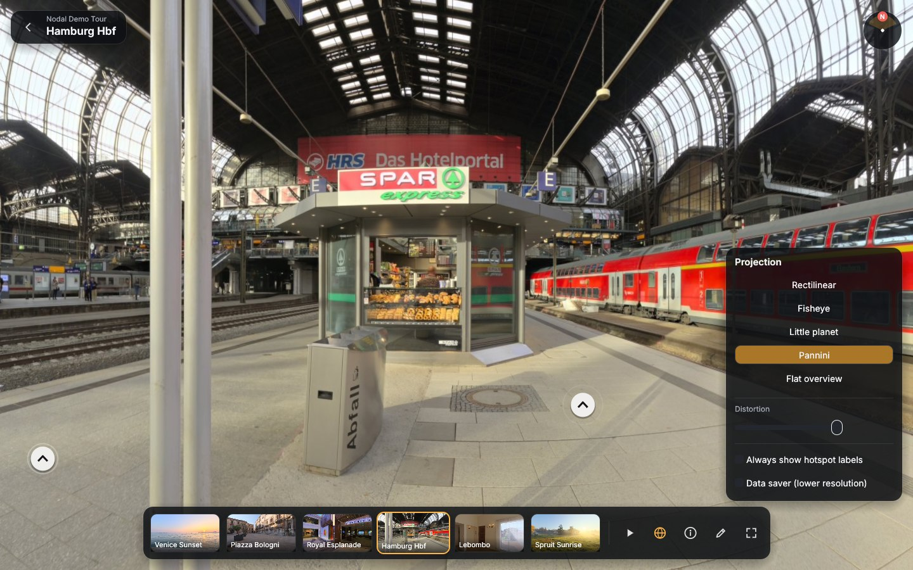
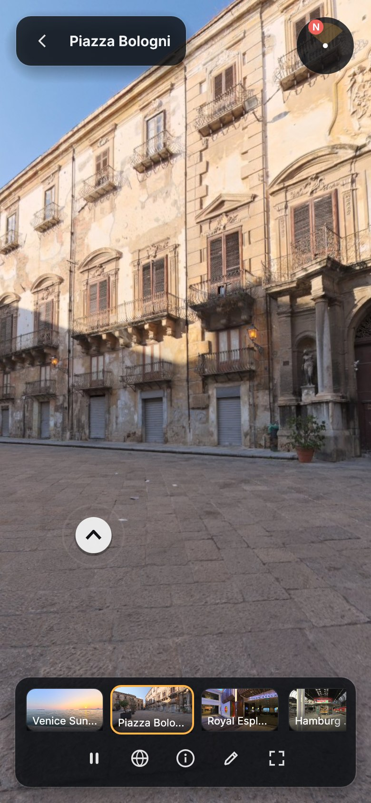

<p align="center"></p>

<h1 align="center">Nodal</h1>
<p align="center"><b>Fast, GPU-accelerated 360° panoramas and virtual tours — native app, web viewer and self-hosted server, written in Rust.</b></p>


Nodal turns equirectangular panoramas into multi-resolution tile pyramids and streams them into a
single-pass GPU renderer. One codebase runs as a **native desktop app** (Vulkan / Metal / DX12),
in the **browser** (WebGPU, falling back to WebGL 2), and as a **Docker server** with a tour library,
browser uploads and a built-in editor.

## Highlights

- **One draw call per frame.** Every pixel inverts the projection analytically — rectilinear,
  fisheye, stereographic "little planet", Pannini, architectural (straight verticals) and a flat
  overview — so wide-angle views are exact, not tessellated approximations. Projections morph smoothly.
- **Virtual texturing.** Tiles stream into a GPU atlas indexed by a per-face page table. Each sample
  resolves the best resident tile in one lookup and blends the two nearest levels (trilinear), so
  detail sharpens progressively from the centre out with no seams — tile borders hold real
  neighbouring pixels, even across cube faces.
- **Fast tiler.** Renders each cube face once at full resolution, then box-filters down the pyramid in
  linear light. Bicubic sampling near 1:1, pole-aware anisotropic filtering, all cores. An 8K
  panorama tiles in ~3 s on two cores.
- **Tours.** Point and polygon hotspots (great-circle edges that stay glued to the scene in every
  projection), zoom-through transitions, info cards, links, look-at animations, compass, autorotate
  with horizon levelling, deep links (`#scene=…&yaw=…&proj=planet`).
- **Editor built in.** Click to place hotspots, click corners to draw areas, drag to move, undo/redo,
  set start views and north, reorder scenes, add panoramas — saved to disk (native) or to the server.
- **Small and quiet.** Repaints only when something moves; 76 MB Docker image; the web viewer is
  2.2 MB (brotli) and served precompressed.

## Screenshots

| Little planet (web) | Tour editor (web) |
|---|---|
|  |  |
| **Tour library (web, server)** | **Native app — Pannini projection** |
|  |  |

<p align="center">
  
  &nbsp;&nbsp;
  
</p>

The demo tour uses six CC0 panoramas from [Poly Haven](https://polyhaven.com) — rebuild it with
`scripts/make-demo.sh`.

## Quick start

### Docker / Unraid

```sh
docker run -d --name nodal -p 8080:8080 \
  -v /path/to/nodal-data:/data \
  -e NODAL_TOKEN=change-me \
  ghcr.io/au12/nodal:latest
```

Open `http://<host>:8080`, click **New tour from panoramas…** (or drop files on the page), and the
tour opens when tiling finishes. On **Unraid**, add the template from
`https://raw.githubusercontent.com/au12/nodal/main/unraid/nodal.xml` (Docker → Add Container →
Template repositories), or paste the URL into *Template*.

### Native app

Download a release binary (Linux, macOS, Windows) or build it (below), then:

```sh
nodal                          # start screen: drop panoramas or open a tour folder
nodal ~/Pictures/pano.jpg      # tiles into a new tour and opens it
nodal path/to/tour             # opens an existing tour
```

Press **E** to edit, **P** to cycle projections, **?** for all shortcuts.

### Command line

```sh
nodal tile -o my-tour --title "My Tour" a.jpg b.jpg c.jpg   # create or extend a tour
nodal tile -o my-tour --hfov 360 --vfov 120 strip.jpg       # partial (cylindrical-ish) panorama
nodal render my-tour --projection little-planet --size 3840x2160 -o planet.jpg   # headless GPU still
nodal info my-tour                                          # summary + broken links
```

A tour is a folder with `tour.json` plus tiles; it can be hosted by any static web server next to
the web viewer (`?tour=path/to/tour.json`).

## How it works

```
 equirect ──► nodal-tiler ──► tiles/{face}/{level}/{y}_{x}.jpg + tour.json
                                              │
                         ┌────────────────────┴────────────────────┐
                         ▼                                          ▼
            nodal-render (wgpu)                           nodal-server (axum)
  plan visible tiles → fetch+decode off-thread      library · uploads · tiling jobs
  → atlas slot (LRU) → page table → 1 draw call     serves tours + web viewer
                         ▲
              nodal-app (egui) — native & web UI, camera, hotspots, editor
```

| Crate | What it does |
|---|---|
| `nodal-core` | Projections (forward + inverse), cube mapping, tile pyramid, tour model. Pure math, unit-tested. |
| `nodal-tiler` | Equirect → bordered multi-res cube tiles, thumbnails, `tour.json`. |
| `nodal-render` | wgpu renderer: per-pixel projection shader, virtual-texture atlas + page table, streaming, transitions, headless rendering. |
| `nodal-app` | The `nodal` binary and the WASM web viewer (eframe/egui). |
| `nodal-server` | Docker server: REST API, background tiling queue, static hosting with precompression. |

**Level of detail.** The shader takes screen-space derivatives of the *view direction* (continuous
across cube faces, unlike texture coordinates), converts them to face-plane derivatives with the
quotient rule, and picks the level where one source texel covers one screen pixel. The CPU planner
runs the same formula on a coarse screen grid to decide what to fetch, most urgent first.

**Page table.** For every tile position at every level, an entry points at the best resident tile
covering it — itself or its nearest resident ancestor. Inserting or evicting a tile only recomputes
its subtree, and the shader never walks the pyramid.

**Correctness.** `cargo test` renders every projection on the GPU (lavapipe in CI) and compares it
with a CPU reference renderer that samples the source equirect directly: 31–38 dB PSNR.

## Tour format

```jsonc
{
  "title": "Nodal Demo Tour",
  "start_scene": "venice-sunset",
  "settings": { "autorotate": { "speed": 4, "delay": 6 }, "transition": { "kind": "zoom_fade", "duration": 0.9 } },
  "scenes": [{
    "id": "royal-esplanade",
    "title": "Royal Esplanade",
    "pyramid": { "tile_size": 326, "border": 1, "levels": 4, "url": "scenes/royal-esplanade/tiles/{f}/{l}/{y}_{x}.jpg" },
    "view": { "yaw": 0, "pitch": 0, "fov": 95 },
    "hotspots": [
      { "id": "go-hamburg", "shape": "point", "yaw": -45, "pitch": -20, "icon": "arrow",
        "label": "Hamburg Hbf", "action": { "type": "goto", "scene": "hamburg-hbf" } },
      { "id": "sign", "shape": "polygon", "points": [[16, 23], [63, 19.5], [63, 12.5], [16, 16]],
        "label": "Shore excursions", "action": { "type": "info", "title": "…", "text": "…" } }
    ]
  }]
}
```

Angles are degrees; yaw turns right, pitch looks up; `fov` spans the longer edge of the screen.
Actions: `goto` (optional arrival `yaw`/`pitch`/`fov`), `info`, `link`, `look_at`.

## Keyboard & mouse

| Input | Action |
|---|---|
| Drag · arrows · WASD | Look around (with inertia) |
| Wheel · pinch · `+` `−` | Zoom towards the cursor |
| Double-click | Zoom in |
| `1`–`9` | Jump to scene |
| `Space` | Toggle auto-rotation |
| `P` | Cycle projections |
| `F` | Fullscreen |
| `E` | Editor (`Ctrl+S` save, `Ctrl+Z` / `Ctrl+Shift+Z` undo/redo, `Del` delete hotspot) |
| `I` · `L` | Stats · level-of-detail debug views |

## Server

| Variable | Default | |
|---|---|---|
| `NODAL_DATA` | `/data` | Tours live in `$NODAL_DATA/tours/<id>/` |
| `NODAL_PORT` | `8080` | |
| `NODAL_TOKEN` | – | If set, uploads/edits/deletes need `Authorization: Bearer <token>` (the web UI asks for it) |
| `NODAL_READONLY` | `false` | Serve only |
| `NODAL_MAX_UPLOAD_MB` | `2048` | |
| `NODAL_QUALITY` | `86` | JPEG tile quality |

| Endpoint | |
|---|---|
| `GET /api/config` | `{writable, auth_required, version}` |
| `GET /api/tours` | Library listing |
| `POST /api/tours` | Body = image bytes, headers `X-Filename`, `X-Title` → tiling job |
| `POST /api/tours/{id}/scenes` | Add a panorama to a tour → tiling job |
| `GET /api/jobs/{id}` | `{state, progress, message, tour}` |
| `PUT /api/tours/{id}` | Save `tour.json` (pyramids always come from disk; dropped scenes are deleted) |
| `DELETE /api/tours/{id}` | Delete a tour |
| `GET /tours/{id}/…` | Tour files (tiles cached for a week, `tour.json` revalidated) |

Without `NODAL_TOKEN`, anyone who can reach the server can upload and delete — keep it on a trusted
network or behind your reverse proxy's auth.

## Building from source

Rust 1.95+.

```sh
cargo build --release                      # nodal (app + CLI) and nodal-server
cargo test --workspace --release           # unit tests + GPU-vs-CPU render test

rustup target add wasm32-unknown-unknown
cargo install wasm-bindgen-cli --version <version of wasm-bindgen in Cargo.lock>
scripts/build-web.sh                       # → dist/web (served by nodal-server)

docker build -t nodal .                    # multi-stage; cross-compiles for arm64 without emulation
```

Add `?backend=webgl` to the viewer URL to force WebGL 2 if a browser's WebGPU driver misbehaves.

## Numbers

Measured in a 2-core cloud VM with a software rasterizer (no GPU), so real hardware is far faster:

| | |
|---|---|
| Tile an 8192×4096 panorama (510 tiles, 4 levels) | 3.1 s |
| Headless 3840×2160 little-planet render (CPU Vulkan, lavapipe) | 1.2 s |
| GPU vs CPU reference, all projections | 31–38 dB PSNR |
| Docker image | 76 MB |
| Web viewer (WASM, brotli) | 2.2 MB |

## Clean room

Nodal is an original, independent implementation. It contains no code from, and was not derived
from, any commercial panorama viewer; it uses only public techniques (cube maps, mip pyramids,
virtual texturing, standard map projections).

## Credits

Demo panoramas: [Poly Haven](https://polyhaven.com) (CC0). UI font: [Inter](https://rsms.me/inter/)
(SIL Open Font License, `crates/nodal-app/assets/Inter-OFL.txt`). Built on
[wgpu](https://wgpu.rs), [egui](https://egui.rs) and [axum](https://github.com/tokio-rs/axum).

MIT licensed — see [LICENSE](LICENSE).
