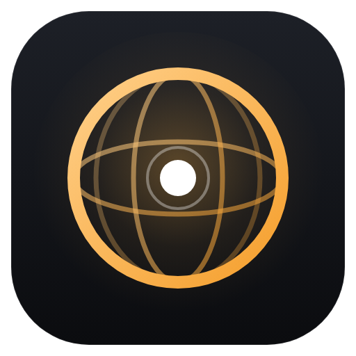
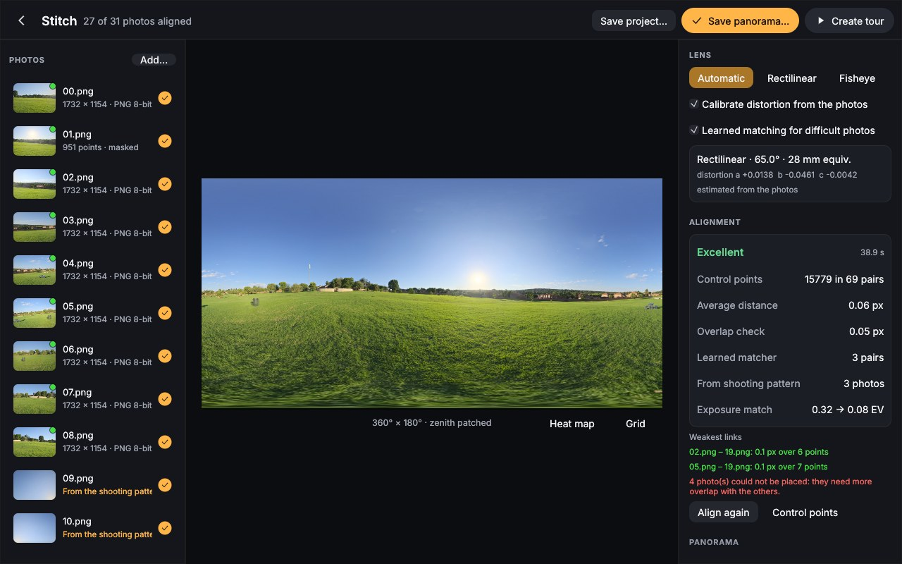
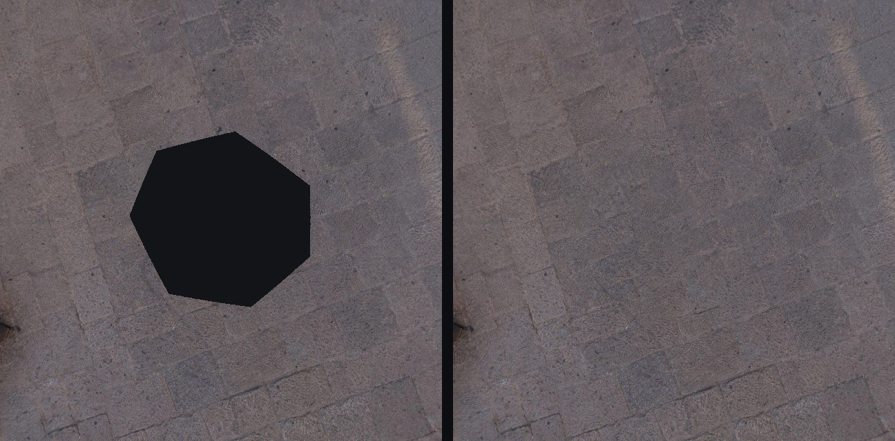
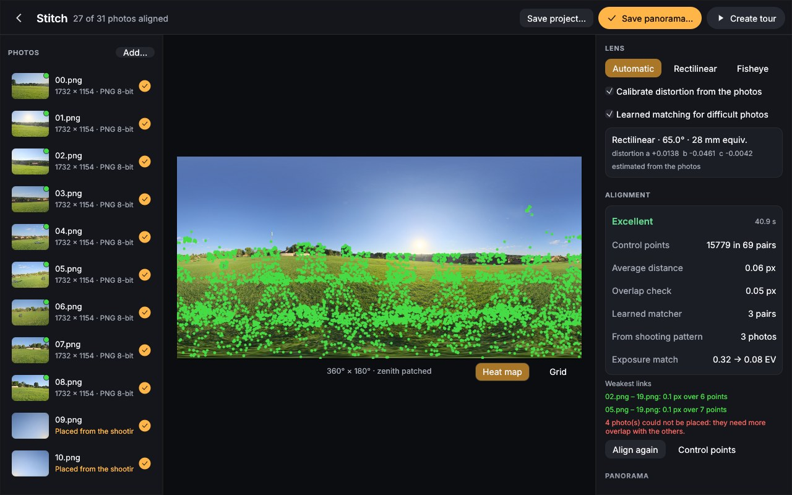
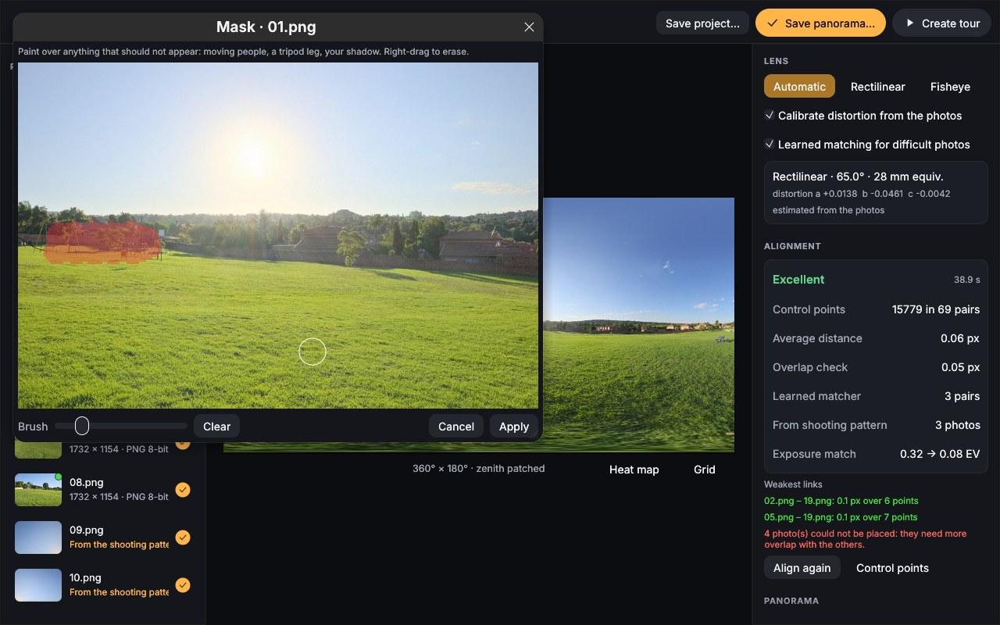
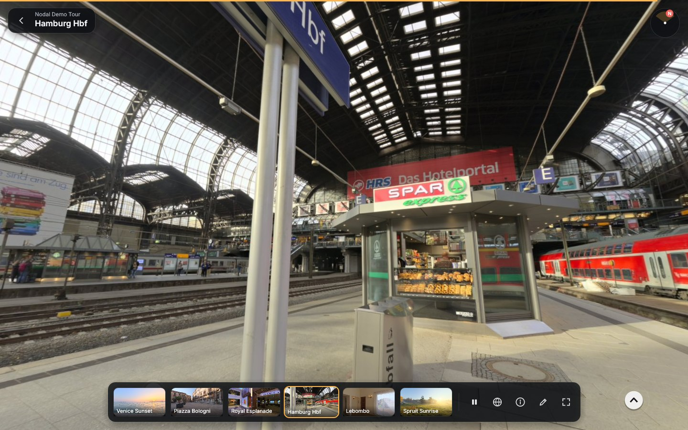
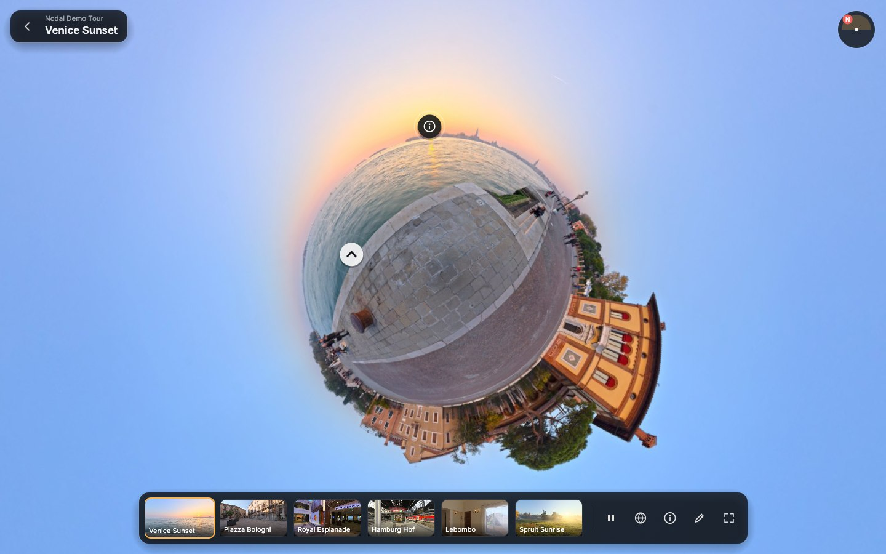
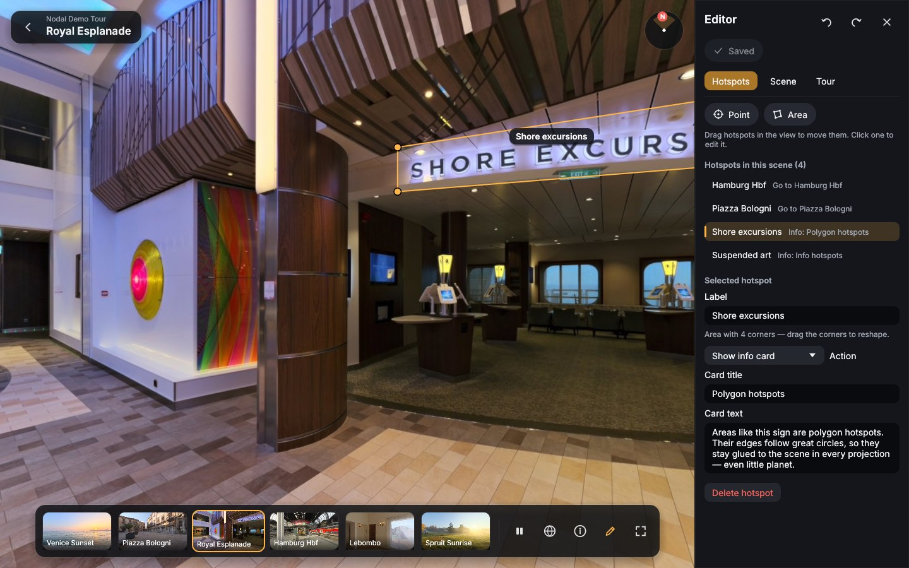
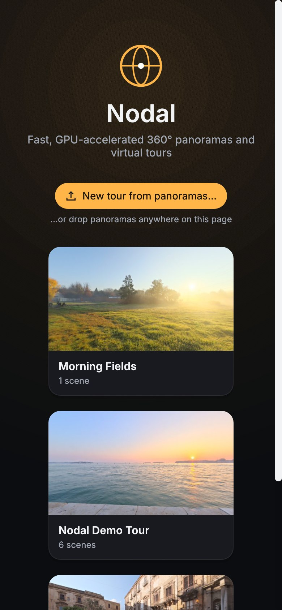
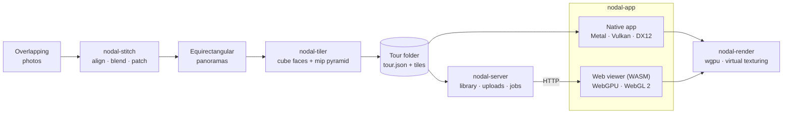

<p align="center"></p>

<h1 align="center">Nodal</h1>

<p align="center">
  <b>Stitch photos into flawless 360° panoramas, then turn them into virtual tours.</b><br>
  A native app for macOS, Linux and Windows, a WebGPU viewer and a self-hosted Docker server, all in Rust.
</p>

<p align="center">
  <a href="https://github.com/au12/Nodal/actions/workflows/ci.yml"></a>
  <a href="https://github.com/au12/Nodal/actions/workflows/docker.yml"></a>
  <a href="https://github.com/au12/Nodal/actions/workflows/macos.yml"></a>
  <a href="https://github.com/au12/Nodal/pkgs/container/nodal"></a>
  <a href="LICENSE"></a>
</p>

<p align="center">
  <a href="#install">Install</a> ·
  <a href="#stitching">Stitching</a> ·
  <a href="#features">Features</a> ·
  <a href="#screenshots">Screenshots</a> ·
  <a href="#how-it-works">How it works</a> ·
  <a href="#server">Server</a> ·
  <a href="#building-from-source">Build</a> ·
  <a href="ROADMAP.md">Roadmap</a>
</p>



Nodal covers the whole panorama workflow in one app:

1. **Stitch.** Drop in overlapping photos from any lens, in any order. Nodal finds the overlaps,
   calibrates the lens, aligns everything to a fraction of a pixel, balances exposure, hides the
   seams and patches the gaps straight up and straight down.
2. **View.** Panoramas are cut into multi-resolution tiles and streamed into a single-pass GPU
   renderer (Metal, Vulkan, DX12, WebGPU with a WebGL 2 fallback).
3. **Publish.** Link panoramas into virtual tours with hotspots in the built-in editor, and share
   them from the **Docker server** or any static web host.

## Install

### 🍎 macOS (Apple Silicon)

1. Download **`Nodal-<version>-macos-arm64.dmg`** from the [latest release](https://github.com/au12/Nodal/releases/latest).
   For the newest build from `main`, open the most recent
   [macOS app run](https://github.com/au12/Nodal/actions/workflows/macos.yml) and download the `Nodal-macOS-arm64` artifact.
2. Open the disk image and drag **Nodal** to **Applications**.
3. First launch: CI builds are ad-hoc signed unless a Developer ID is configured (see [CI](#ci--releases)), so Gatekeeper asks once.
   - **macOS 15 and later:** open Nodal, choose **Done**, then go to **System Settings → Privacy & Security** and click **Open Anyway**.
   - **macOS 11–14:** right-click **Nodal** in Applications and choose **Open**.
   - Or from Terminal: `xattr -dr com.apple.quarantine /Applications/Nodal.app`

The app bundle also contains the command-line tools: `/Applications/Nodal.app/Contents/MacOS/nodal --help`.

### 🐳 Docker

```sh
docker run -d --name nodal -p 8080:8080 \
  -v /path/to/nodal-data:/data \
  -e NODAL_TOKEN=change-me \
  ghcr.io/au12/nodal:latest
```

<details>
<summary>docker compose</summary>

```yaml
services:
  nodal:
    image: ghcr.io/au12/nodal:latest
    container_name: nodal
    ports:
      - "8080:8080"
    volumes:
      - ./nodal-data:/data
    environment:
      NODAL_TOKEN: change-me   # needed for uploads, edits and deletes; viewing stays public
    restart: unless-stopped
```

</details>

Open `http://<host>:8080`, click **New tour from panoramas…** or drop images on the page, and the tour
opens as soon as tiling finishes. The image is built for `linux/amd64` and `linux/arm64`.

### 🟧 Unraid

Install the template from the Unraid terminal, then add the container from it:

```sh
wget -O /boot/config/plugins/dockerMan/templates-user/my-Nodal.xml \
  https://raw.githubusercontent.com/au12/Nodal/main/unraid/nodal.xml
```

Go to **Docker → Add Container**, pick **Nodal** under *User templates*, set an **Access token** and click **Apply**.
Tours are stored in `/mnt/user/appdata/nodal`.

### 🐧 Linux and 🪟 Windows

Tagged releases include `nodal` archives for Linux (x86_64, arm64) and Windows (x86_64), or you can
[build it](#building-from-source) yourself.

## Using it

```sh
nodal                          # start screen: drop photos, panoramas or a tour folder
nodal IMG_01.jpg IMG_02.jpg …  # overlapping photos open in the stitching workspace
nodal holiday.nodal             # reopens a saved stitching project
nodal ~/Pictures/pano.jpg      # a finished 2:1 panorama is tiled into a new tour and opened
nodal path/to/tour             # opens an existing tour
```

In the viewer, press **E** to edit, **P** to cycle projections and **?** for every shortcut. The same
binary is a command-line tool:

```sh
nodal stitch IMG_*.jpg -o pano.jpg                          # stitch photos into a panorama
nodal stitch RAW/*.CR3 -o pano.tif                          # RAW in, 16-bit TIFF out (also .png, .psd)
nodal stitch IMG_*.jpg -o pano.jpg --nadir-patch 25 --tour my-tour   # paint out the tripod, build a tour
nodal tile -o my-tour --title "My Tour" a.jpg b.jpg c.jpg   # create or extend a tour from panoramas
nodal render my-tour --projection little-planet --size 3840x2160 -o planet.jpg   # headless GPU still
nodal info my-tour                                          # summary + broken links
nodal bench                                                 # time the stitcher on this machine
nodal bench --suite                                         # accuracy against ground truth
```

`--projection` accepts `rectilinear`, `fisheye`, `stereographic`, `little-planet`, `pannini` and `equirect`.
A tour is a folder with `tour.json` and tiles, so any static web server can host it next to the web
viewer (`?tour=path/to/tour.json`).

## Stitching

Stitching is fully automatic, and every step can be inspected or overridden in the workspace.

- **Any camera file.** JPEG, PNG, WebP, 8/16/32-bit TIFF (BigTIFF included), Photoshop PSD/PSB, and
  RAW from most cameras (CR3, CR2, NEF, ARW, RAF, DNG, ORF, RW2 and more, decoded by
  [FlashRaw](https://crates.io/crates/flashraw)). Everything is processed scene-linear in floating
  point, embedded ICC profiles are honoured, and all RAW frames share one white balance so colours
  match across the set.
- **Any lens.** Rectilinear and fisheye. The fisheye's projection (equidistant, equisolid,
  stereographic or anything in between) is measured from the photos, together with field of view,
  radial distortion, lens shift and vignetting. A lens parameter is only kept if it predicts control
  points it was not fitted to.
- **Every photo placed.** All overlaps are verified and placed at once by robust rotation averaging,
  so rings close and a false match is voted out by the cycles it breaks. When features cannot connect a
  photo (low texture, cloudy sky, repeated patterns), a learned matcher (RaCo-ALIKED + LightGlue on
  ONNX Runtime) tries again; its models download once, about 65 MB, the first time they are needed
  (`--no-learned` turns it off). Photos with nothing to match at all, like clear sky, are placed from
  the shooting pattern where they fill a gap, and flagged as such.
- **Dense overlap registration.** After the global solve every overlap is measured densely at
  sub-pixel precision, which feeds a second adjustment and smooth per-photo warps that take out the
  parallax of hand-held shooting.
- **Invisible seams.** Exposure, white balance and vignetting are solved jointly from the overlaps.
  Moving people and shadows are found by consensus and kept out of the blend, seams are routed by
  minimum cuts through areas where the photos agree, and multi-band blending mixes each frequency band
  over a distance that suits it.
- **No holes.** Zenith, nadir and any gap between photos are filled with smooth, texture-matched
  patches (or left transparent: turn off *Fill voids*). `--nadir-patch` also paints out a tripod.
- **Level and centred.** The horizon is levelled automatically; drag the preview to re-centre it.
  While you drag, the preview is re-projected live on the GPU.
- **Output.** 8-bit JPEG, or 16-bit TIFF (BigTIFF when large), PNG and PSD/PSB, with an sRGB profile
  and Photo Sphere (GPano) metadata, at the photos' native resolution or any size. Full-resolution
  photos are streamed from disk while rendering, and RAWs are decoded at half size when the output
  cannot use more. Partial panoramas are trimmed to a clean rectangle. One click builds a tour.
- **A workspace that shows its work.** A heat map of every control point's residual on the preview,
  a per-photo agreement dot, the weakest links by name, a mask painter for anything that should not
  appear (people, a tripod leg, your shadow) and a control point table.
- **Projects.** Save a stitch as a `.nodal` file and reopen it later with its alignment, lens, masks
  and settings intact.



*Looking straight down in a 23-photo panorama: the gap the photos left under the camera (left) and
the automatic patch (right).*

**Accuracy.** `nodal bench --suite` renders photo sets from a known panorama through lenses the
solver is not told about, stitches them end to end and measures *true misregistration*: how far
apart the solved model places the same scene point in two photos, in source pixels. That is the
ghosting you would see, and unlike control-point error the optimiser cannot flatter it.

| Set | Placed | Median | 95th pct | Max | Lens found |
|---|---|---|---|---|---|
| 8 fisheye frames, equidistant | 8/8 | 0.03 px | 0.08 px | 0.27 px | equidistant 110.0° |
| 8 fisheye frames, equisolid | 8/8 | 0.04 px | 0.14 px | 1.2 px | equisolid (k = −0.48) 110.0° |
| 8 fisheye frames, stereographic | 8/8 | 0.03 px | 0.08 px | 0.61 px | stereographic (k = 0.42) 110.0° |
| 31 low-texture rectilinear frames, five rows | 31/31 | 0.07 px | 0.19 px | 0.92 px | 65.0° (learned matcher on 24 pairs) |
| 7 rectilinear frames, partial panorama | 7/7 | 0.09 px | 0.24 px | 0.49 px | 60.0° |

For comparison, 0.2 treated every fisheye as equidistant (on a 180° equisolid set that left errors up
to 7.2 px at the frame edges) and placed 11 of the 31 low-texture photos.

**Limits to know about.** Stitching currently runs in the native app and CLI, not in the web or
Docker UI, and on the CPU (the GPU path is on the [roadmap](ROADMAP.md)). Exposure brackets are not
merged into HDR yet. Pole patches are synthesised, not photographed: plain sky, pavement, grass and
floors come out convincingly, while complex structure directly overhead (a station roof, a street
canyon) can look invented. A frame of pure sky in a row the photos never established cannot be
placed.

## Features

**Viewer**
- **One draw call per frame.** Every pixel inverts its projection analytically: rectilinear, fisheye,
  stereographic "little planet", Pannini, architectural (straight verticals) and a flat overview.
  Wide angles are exact rather than tessellated approximations, and projections morph smoothly.
- **Virtual texturing.** Tiles stream into a GPU atlas indexed by a per-face page table. Each sample
  finds the best resident tile in one lookup and blends the two nearest levels, so detail sharpens
  progressively from the centre out with no seams. Tile borders hold real neighbouring pixels, even
  across cube faces.
- **Runs everywhere.** Metal on macOS, Vulkan or GL on Linux, DX12 on Windows, and WebGPU or WebGL 2
  in the browser, with touch and pinch on phones.
- **Quiet.** It repaints only when something moves.

**Tours and editing**
- Point and polygon hotspots whose great-circle edges stay glued to the scene in every projection.
- Zoom-through transitions, info cards, links, look-at animations, a compass, and auto-rotation with
  horizon levelling.
- Deep links such as `#id=my-tour&scene=lobby&yaw=40&fov=70&proj=planet`.
- A built-in editor in the native app and the browser: click to place hotspots, click corners to draw
  areas, drag to move, undo and redo, set start views and north, and reorder or add scenes.

**Stitcher**
- A complete stitching engine (see [Stitching](#stitching)): RAW, TIFF and PSD input, a linear float
  pipeline, feature and learned matching, rotation averaging, lens calibration, dense overlap
  registration, parallax warps, photometric calibration, ghost masks, minimum-cut seams, multi-band
  blending, void filling and 16-bit output.
- Multi-threaded throughout, with a GPU live preview while you re-centre or level the panorama.

**Tiler and server**
- The tiler renders each cube face once at full resolution, then box-filters down the pyramid in
  linear light, using bicubic sampling near 1:1 and pole-aware filtering on all cores. An 8K panorama
  tiles in about 3 s on two cores.
- The server provides a tour library, streamed uploads, background tiling jobs, token auth and a
  read-only mode. Its image is 76 MB (distroless, multi-arch), and the 2.2 MB web viewer (brotli) is
  served precompressed.

## Screenshots

**Stitching workspace (native)**


| Residual heat map | Mask painter |
|---|---|
|  |  |

**Desktop (web)**

| Viewer | Little planet |
|---|---|
|  |  |
| **Tour editor** | **Tour library** |
|  |  |

**Mobile (web)**

<p align="center">
  
  &nbsp;&nbsp;
  
</p>

**Native app, Pannini projection**


The demo tour uses six CC0 panoramas from [Poly Haven](https://polyhaven.com); rebuild it with
`scripts/make-demo.sh`.

## How it works



| Crate | What it does |
|---|---|
| `nodal-core` | Projections (forward and inverse), cube mapping, the tile pyramid and the tour model. Pure math with unit tests. |
| `nodal-stitch` | The stitching engine: RAW/TIFF/PSD decoding, EXIF and lens models, features, learned rescue matching (`ml` feature), rotation averaging, bundle adjustment, dense registration and warps, photometric calibration, seams, blending, void filling and 16-bit encoding. |
| `nodal-tiler` | Converts equirect images into bordered multi-resolution cube tiles, thumbnails and `tour.json`. |
| `nodal-render` | The wgpu renderer: per-pixel projection shader, virtual-texture atlas and page table, streaming, transitions, headless rendering and the live stitch-preview compositor. |
| `nodal-app` | The `nodal` binary (app and CLI) and the WASM web viewer, built on eframe/egui. |
| `nodal-server` | The Docker server: REST API, background tiling queue and static hosting with precompression. |

**Level of detail.** The shader takes screen-space derivatives of the *view direction*, which stays
continuous across cube faces unlike texture coordinates. It converts them to face-plane derivatives
with the quotient rule and picks the level where one source texel covers one screen pixel. The CPU
planner runs the same formula on a coarse screen grid to decide what to fetch, most urgent first.

**Page table.** For every tile position at every level, an entry points at the best resident tile
covering it: either that tile or its nearest resident ancestor. Inserting or evicting a tile only
recomputes its subtree, so the shader never walks the pyramid.

**Correctness.** `cargo test` renders every projection on the GPU (lavapipe in CI) and compares the
result with a CPU reference renderer that samples the source equirect directly. They agree to 31–38 dB PSNR.

## Tour format

```jsonc
{
  "title": "Nodal Demo Tour",
  "start_scene": "venice-sunset",
  "settings": { "autorotate": { "speed": 4, "delay": 6, "max_seconds": 180 }, "transition": { "kind": "zoom_fade", "duration": 0.9 } },
  "scenes": [{
    "id": "royal-esplanade",
    "title": "Royal Esplanade",
    "pyramid": { "tile_size": 326, "border": 1, "levels": 4, "url": "scenes/royal-esplanade/tiles/{f}/{l}/{y}_{x}.jpg" },
    "view": { "yaw": 0, "pitch": 0, "fov": 95 },
    "hotspots": [
      { "id": "go-hamburg", "shape": "point", "yaw": -45, "pitch": -20, "icon": "arrow",
        "label": "Hamburg Hbf", "action": { "type": "goto", "scene": "hamburg-hbf" } },
      { "id": "sign", "shape": "polygon", "points": [[16, 23], [63, 19.5], [63, 12.5], [16, 16]],
        "label": "Shore excursions", "action": { "type": "info", "title": "…", "text": "…" } }
    ]
  }]
}
```

Angles are in degrees: yaw turns right, pitch looks up, and `fov` spans the longer edge of the screen.
The actions are `goto` (with an optional arrival `yaw`, `pitch` and `fov`), `info`, `link` and `look_at`.

Auto-rotation starts after `delay` seconds without input and winds down after `max_seconds`, so a
tour left open does not keep the GPU busy. Set `max_seconds` to `0` for a kiosk that rotates forever.
The viewer draws only when something changes: a still panorama uses no GPU or CPU time.

## Keyboard and mouse

| Input | Action |
|---|---|
| Drag · arrows · WASD | Look around (with inertia) |
| Wheel · pinch · `+` `−` | Zoom towards the cursor |
| Double-click | Zoom in |
| `1`–`9` | Jump to a scene |
| `Space` | Toggle auto-rotation |
| `P` | Cycle projections |
| `F` | Fullscreen |
| `E` | Editor (`Ctrl+S` save, `Ctrl+Z` / `Ctrl+Shift+Z` undo/redo, `Del` delete hotspot) |
| `I` · `L` | Stats · level-of-detail debug views |

## Server

| Variable | Default | |
|---|---|---|
| `NODAL_DATA` | `/data` | Tours are stored in `$NODAL_DATA/tours/<id>/` |
| `NODAL_PORT` | `8080` | |
| `NODAL_TOKEN` | – | If set, uploads, edits and deletes need `Authorization: Bearer <token>` (the web UI asks for it once) |
| `NODAL_READONLY` | `false` | Serve tours only |
| `NODAL_MAX_UPLOAD_MB` | `2048` | |
| `NODAL_QUALITY` | `86` | JPEG tile quality |

| Endpoint | |
|---|---|
| `GET /api/config` | `{writable, auth_required, version}` |
| `GET /api/tours` | Library listing |
| `POST /api/tours` | Body = image bytes, headers `X-Filename` and `X-Title`; starts a tiling job |
| `POST /api/tours/{id}/scenes` | Adds a panorama to a tour; starts a tiling job |
| `GET /api/jobs/{id}` | `{state, progress, message, tour}` |
| `PUT /api/tours/{id}` | Saves `tour.json`. Pyramids always come from disk, and dropped scenes are deleted |
| `DELETE /api/tours/{id}` | Deletes a tour |
| `GET /tours/{id}/…` | Tour files. Tiles are cached for a week and `tour.json` is revalidated |
| `GET /healthz` | Liveness; the image's `HEALTHCHECK` runs `nodal-server healthcheck` |

> [!WARNING]
> Without `NODAL_TOKEN`, anyone who can reach the server can upload and delete tours. Keep it on a
> trusted network or behind your reverse proxy's authentication.

## Building from source

Requires Rust 1.95 or later.

```sh
cargo build --release                      # nodal (app + CLI) and nodal-server
cargo test --workspace --release           # unit tests + GPU-vs-CPU render test

rustup target add wasm32-unknown-unknown
cargo install wasm-bindgen-cli --version <wasm-bindgen version from Cargo.lock>
scripts/build-web.sh                       # → dist/web (served by nodal-server)

docker build -t nodal .                    # multi-stage; cross-compiles arm64 without emulation
scripts/smoke-test-docker.sh nodal         # end-to-end check of an image

# macOS: Nodal.app + DMG (run on a Mac)
cargo build --release -p nodal-app --bin nodal --target aarch64-apple-darwin
scripts/package-macos.sh                   # → dist/macos/Nodal.app, Nodal-<version>-macos-arm64.dmg
```

On Linux the native app needs the usual windowing libraries (`libxkbcommon`, `libwayland`). Add
`?backend=webgl` to the viewer URL to force WebGL 2 if a browser's WebGPU driver misbehaves.

## CI & releases

| Workflow | Trigger | What it does |
|---|---|---|
| [CI](.github/workflows/ci.yml) | push, PR | `rustfmt`, `clippy -D warnings` (native and wasm32), and tests including the GPU-vs-CPU render comparison on lavapipe |
| [Unraid Docker image](.github/workflows/docker.yml) | push to `main`, `v*` tags, PR | Validates `unraid/nodal.xml`, builds the image and runs an end-to-end smoke test (health, auth, upload → tiling → serving). It then pushes `linux/amd64` + `linux/arm64` to `ghcr.io/au12/nodal` as `latest`, `X.Y.Z`, `X.Y` and `sha-…`; PRs build and test only |
| [macOS app](.github/workflows/macos.yml) | push to `main`, PR, called by Release | Builds `Nodal.app` for Apple Silicon, runs a CLI smoke test and packages a DMG, which is uploaded as the `Nodal-macOS-arm64` artifact |
| [Release](.github/workflows/release.yml) | `v*` tags | Builds Linux x86_64/arm64 and Windows x86_64 archives plus the macOS app, then publishes one GitHub release. The notes come from [CHANGELOG.md](CHANGELOG.md), and every file is attached with `SHA256SUMS.txt` |

**Cutting a release.** Move the *Unreleased* notes in `CHANGELOG.md` under a new version heading,
bump `version` in `Cargo.toml`, then push a tag:

```sh
git tag v0.2.0 && git push origin v0.2.0
```

You can also create the tag from the **Releases** page (*Draft a new release* → new tag → *Publish*).
The workflow fills in the notes if you leave them empty, then attaches the binaries a few minutes later.
`docker.yml` publishes the matching `X.Y.Z`, `X.Y` and `latest` image tags.

**Mac signing (optional).** Add these repository secrets and the macOS workflow signs with your
Developer ID using the hardened runtime, then notarizes and staples the disk image. Users then skip the
Gatekeeper step.

| Secret | |
|---|---|
| `MACOS_CERTIFICATE` | Base64 of a *Developer ID Application* `.p12` (`base64 -i cert.p12 \| pbcopy`) |
| `MACOS_CERTIFICATE_PASSWORD` | The `.p12` password |
| `MACOS_SIGNING_IDENTITY` | e.g. `Developer ID Application: Your Name (TEAMID)` |
| `APPLE_ID` · `APPLE_TEAM_ID` · `APPLE_APP_PASSWORD` | Notarization (an app-specific password from appleid.apple.com) |

> [!NOTE]
> If `docker pull ghcr.io/au12/nodal` asks you to log in (this happens with forks or private repos),
> set the package to **Public** under *Package settings → Change visibility*.

## Roadmap

Coming up next are GPU warping and blending, exposure-bracket (HDR) merging, global multi-label seams,
viewpoint-corrected nadir shots, stitching in the Docker web UI, a notarized Mac app and a Windows
installer. See **[ROADMAP.md](ROADMAP.md)** for the full plan and known limitations.

## Numbers

These were measured on a 2-core cloud VM with a software rasterizer and no GPU, so real hardware is
much faster. Run `nodal bench` to measure your own machine.

| | |
|---|---|
| Align 8 fisheye photos (features, matching, calibration, sub-pixel refinement) | 4.7 s |
| Align 23 rectilinear photos in three rows (8,800 control points) | 15 s |
| Render that set to 6000×3000 with seams, blending and both poles patched | 14 s |
| Align 41 hand-held 20 MP RAW frames (CR3): matching, rotation averaging, 218,000 dense measurements, warps, photometric solve | 55 s |
| Render them to 8192×4096 16-bit TIFF (half-size RAW decode) | 41 s |
| Tile an 8192×4096 panorama (510 tiles, 4 levels) | 3.1 s |
| Headless 3840×2160 little-planet render (CPU Vulkan, lavapipe) | 1.2 s |
| GPU vs CPU reference, all projections | 31–38 dB PSNR |
| Docker image | 76 MB |
| Web viewer (WASM, brotli) | 2.2 MB |

## Clean room

Nodal is an original, independent implementation. It contains no code from any commercial panorama
viewer or stitcher and was not derived from one. It uses only published techniques: SIFT features,
learned features and matching (RaCo, ALIKED, LightGlue), rotation averaging, bundle adjustment,
block-correlation registration, graph-cut seams, Laplacian-pyramid blending, PatchMatch synthesis,
cube maps, mip pyramids, virtual texturing and standard map projections.

## Credits

Demo panoramas, and the synthetic photo sets in the stitching screenshots, come from
[Poly Haven](https://polyhaven.com) (CC0). The UI font is
[Inter](https://rsms.me/inter/) (SIL Open Font License, `crates/nodal-app/assets/Inter-OFL.txt`).
Nodal is built on [wgpu](https://wgpu.rs), [egui](https://egui.rs) and [axum](https://github.com/tokio-rs/axum).
RAW decoding is [FlashRaw](https://crates.io/crates/flashraw), colour management
[moxcms](https://crates.io/crates/moxcms), and the learned matcher runs on
[ONNX Runtime](https://onnxruntime.ai) through [ort](https://ort.pyke.io).

The learned matcher's models are downloaded at first use, not shipped: RaCo (Apache-2.0, ETH Zürich
CVG), ALIKED descriptors (BSD-3-Clause, Zhao et al.) and LightGlue (Apache-2.0, ETH Zürich CVG), in
the ONNX exports published by [kornia](https://huggingface.co/kornia).

Nodal is MIT licensed; see [LICENSE](LICENSE).
